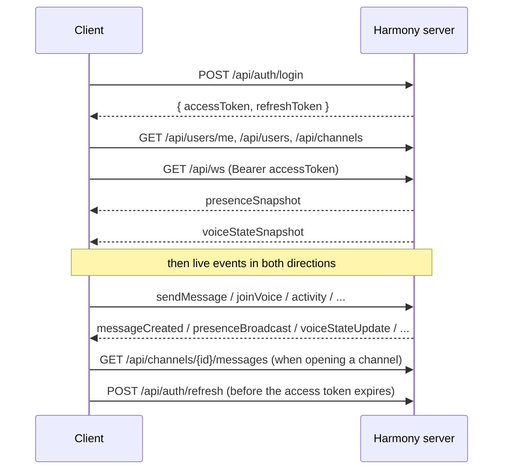

# Harmony protocol documentation

This folder documents everything a client needs to talk to a Harmony server. It is written for people building a **compatible client** (desktop, mobile, bot, CLI…), and for server contributors who need to know what the wire contract is.

| Document | What it covers |
|---|---|
| [REST API](rest-api.md) | Authentication, users, channels, message history |
| [WebSocket protocol](websocket.md) | The real-time connection: envelope, events, errors, chat |
| [Presence](presence.md) | Online / idle / offline, invisible mode, activity heartbeat |
| [Voice](voice.md) | Voice channels: signaling, WebRTC requirements, mute/deafen, speaking |
| [Self-hosting](self-hosting.md) | Running a server: configuration, ports, data, backups |

> **Stability.** Harmony is pre-1.0: the protocol may still change between versions. Breaking changes will be called out in release notes.

## Concepts

- **One server = one community.** There are no "guilds": a Harmony instance hosts a single community made of users and channels.
- **Users** register with a username, an email and a password.
- **Channels** are either `text` or `voice`.
- **No roles yet.** Every authenticated user can create, rename and delete channels and users. Clients should not assume any permission model beyond "authors edit and delete their own messages".
- **IDs** are opaque strings (currently UUIDs). Don't parse them.
- **Timestamps** are UTC, ISO 8601 / RFC 3339 strings, e.g. `"2026-11-02T16:04:05Z"`.
- **JSON** field names are `camelCase`.

## Two transports

| | REST (`/api/...`) | WebSocket (`/api/ws`) |
|---|---|---|
| Use for | Login, loading initial state (users, channels, message history), managing users/channels | Everything live: sending/receiving messages, presence, voice signaling |
| Auth | `Authorization: Bearer <accessToken>` | Same, at the handshake (or `?token=`) |

The server also uses **WebRTC** (UDP) for voice audio, negotiated over the WebSocket. See [voice.md](voice.md).

## Client lifecycle

A typical client:

1. **Logs in** (`POST /api/auth/login`) and stores both tokens.
2. **Loads the initial state** over REST: current user, all users, all channels.
3. **Opens the WebSocket** with the access token. The first two frames are always `presenceSnapshot` then `voiceStateSnapshot`; every event after them is a live update on top of those snapshots.
4. **Loads message history** over REST when the user opens a text channel.
5. **Sends and receives** messages, presence and voice events over the WebSocket.
6. **Refreshes** the access token (`POST /api/auth/refresh`) before it expires (15 minutes by default). An open WebSocket is not closed when its access token expires; the new token only matters for REST calls and the next WebSocket connection.
7. **Reconnects** the WebSocket after a drop (with backoff) and treats the new snapshots as the source of truth. Messages sent while disconnected must be fetched again over REST.

## What is *not* pushed in real time (yet)

Clients should know these current limitations:

- Channel and user changes (create, rename, delete) are **not** broadcast. Re-fetch `/api/channels` and `/api/users` when needed (e.g. on reconnect, or when an event references an unknown ID).
- Message mutations done through **REST** are not broadcast; only WebSocket `sendMessage` / `editMessage` / `deleteMessage` are. Prefer the WebSocket for chat.
- Chat events are broadcast to **every** connected client, whatever the channel. Filter on `channelId`.
- Message history is not paginated.

## Reference implementations

- [`internal/voiceclient`](../internal/voiceclient/voiceclient.go): a minimal headless voice client in Go (Pion) showing the exact offer/answer/candidate handling the server expects.
- [`cmd/voicebot`](../cmd/voicebot/main.go): a command-line bot built on it (login, join a voice channel, send/receive audio).
- The end-to-end tests in [`internal/server`](../internal/server) exercise every event described here against a real server. When this documentation and the tests disagree, the tests are right (please open an issue).
