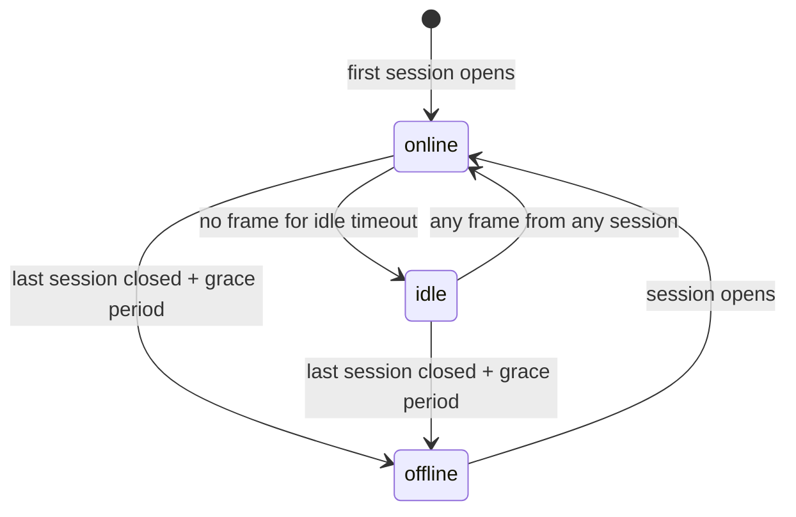

# Presence

Presence tells clients who is around. The **server derives the status**: clients only report activity and choose whether they are invisible.

## Model

| Status | Meaning |
|---|---|
| `online` | At least one session is open and the user was active recently |
| `idle` | Sessions are open, but no frame was received for `HARMONY_PRESENCE_IDLE_TIMEOUT` (default 5 min) |
| `offline` | No open session (after a grace period) |

There is no "do not disturb" status.

Transitions:



- **Idle** is checked every 15 seconds, so a user goes idle between *timeout* and *timeout + 15 s* after their last frame.
- **Offline grace**: when the last session closes, the server waits `HARMONY_PRESENCE_OFFLINE_GRACE` (default 10 s) before announcing `offline`. A reconnect within that window (network blip, app restart) causes no status change at all.
- **Multiple sessions**: a user stays online while any session is open; activity on any session counts.
- Status lives in server memory: after a server restart, everyone starts offline until they reconnect.

## Invisible mode

Invisible is the only presence setting a user controls. It is stored in the database, so it survives reconnects and restarts.

While invisible:

- **Other users** see the user as `offline`: they don't appear in other users' snapshots and nothing about them is broadcast (no idle/online changes, so activity doesn't leak).
- **The user's own sessions** see the real status plus `"invisible": true`.
- The user is still shown in voice channels they join.

The `invisible` field is only ever included in payloads sent to the user themselves.

## Events

### `presenceSnapshot`

Server → client, always the first frame after connecting.

```json
{
  "type": "presenceSnapshot",
  "data": {
    "presences": [
      { "userId": "0b8e…", "status": "online", "invisible": false },
      { "userId": "77aa…", "status": "idle" }
    ]
  }
}
```

- Lists every user who is not offline and visible to you, **plus your own entry** (which has `invisible`).
- Users missing from the list are `offline`. To display a member list, combine it with `GET /api/users`.
- Your own entry is how you learn your current invisible setting at startup.

A new session does not receive a `presenceBroadcast` for its own connection: the snapshot already reflects it.

### `presenceBroadcast`

Server → client, whenever a user's presence changes.

```json
{ "type": "presenceBroadcast", "data": { "userId": "77aa…", "status": "offline" } }
```

When the change concerns **you**, your sessions get your real status plus your invisible flag:

```json
{ "type": "presenceBroadcast", "data": { "userId": "0b8e…", "status": "online", "invisible": true } }
```

Apply each broadcast to your local state; `status` replaces whatever you had for `userId`.

### `presenceUpdate`

Client → server: toggle invisible mode.

```json
{ "type": "presenceUpdate", "requestId": "r1", "data": { "invisible": true } }
```

`invisible` (boolean) is required, otherwise you get `VALIDATION_ERROR`. On success:

- your sessions receive a `presenceBroadcast` with `"invisible": true` and your real status;
- other users receive a `presenceBroadcast` with `"status": "offline"` (or your real status when you become visible again).

Setting the value you already have does nothing (no broadcast).

### `activity`

Client → server: "the user is here".

```json
{ "type": "activity", "data": {} }
```

Any frame counts as activity, but a client that is just sitting open doesn't send frames, so it goes idle. Send `activity` when you detect **real user input** (keyboard, mouse, touch, window focus), **throttled to about once per minute**.

Don't send `activity` on a timer: the user would never go idle.
