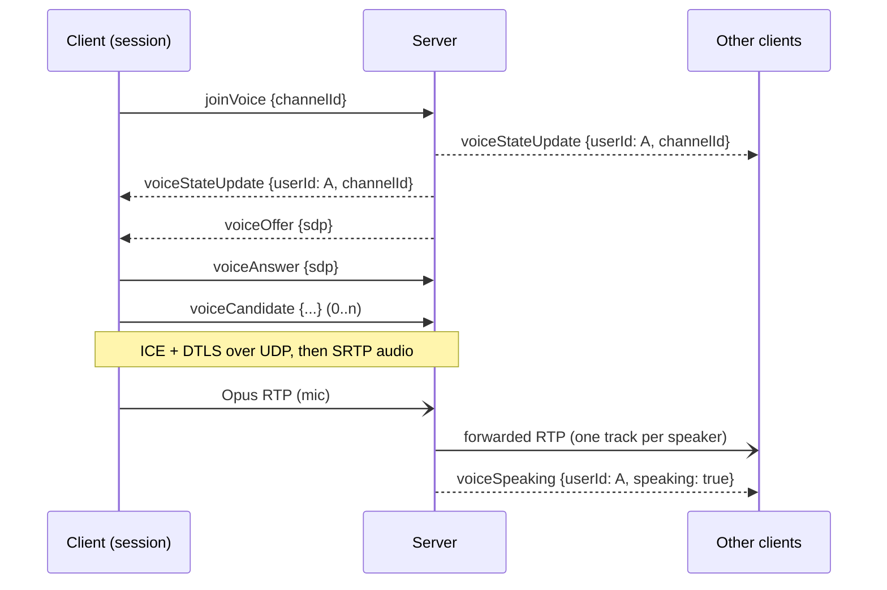

# Voice

Voice channels use **WebRTC** with a built-in **SFU** (Selective Forwarding Unit): every participant sends one audio stream to the server, and the server forwards it as-is to the other participants of the channel. There is no peer-to-peer connection, no mixing and no transcoding.

The WebSocket carries the voice state and the WebRTC signaling (SDP and ICE). Audio travels over UDP.

## Overview



## Voice state

A **user** is in at most one voice channel at a time, from one **session** (device).

### `voiceStateUpdate`

Server → everyone, whenever someone joins, moves, leaves, or changes mute/deafen.

```json
{
  "type": "voiceStateUpdate",
  "data": {
    "userId": "0b8e…",
    "channelId": "5f1c…",
    "muted": false,
    "selfMuted": false,
    "deafened": false,
    "speaking": false
  }
}
```

| Field | Meaning |
|---|---|
| `channelId` | Voice channel the user is in, **`null` when they left** |
| `selfMuted` | The user muted their microphone |
| `deafened` | The user deafened (receives no audio) |
| `muted` | **Effective** mute: `selfMuted || deafened`. Use this for the UI icon. |
| `speaking` | Currently speaking (see [`voiceSpeaking`](#voicespeaking)) |

Each update carries the full state, so it replaces what you had for `userId`.

### `voiceStateSnapshot`

Server → new session, second frame after connecting (after `presenceSnapshot`). It lists everyone currently in voice:

```json
{ "type": "voiceStateSnapshot", "data": { "states": [ { "userId": "…", "channelId": "…", "muted": false, "selfMuted": false, "deafened": false, "speaking": true } ] } }
```

Voice state lives in server memory: after a server restart, nobody is in voice.

## Joining and leaving

### `joinVoice`

```json
{ "type": "joinVoice", "requestId": "r1", "data": { "channelId": "5f1c…" } }
```

| Error | When |
|---|---|
| `VALIDATION_ERROR` | `channelId` missing |
| `NOT_FOUND` | Unknown channel |
| `NOT_VOICE_CHANNEL` | It's a text channel |
| `VOICE_CHANNEL_FULL` | The channel has `HARMONY_VOICE_MAX_PARTICIPANTS` users (default 25) |

On success:

- everyone (you included) receives `voiceStateUpdate` with your `channelId`;
- your session receives a `voiceOffer` and must start the [WebRTC negotiation](#signaling). These two frames may arrive in either order.

Special cases:

- **Already in voice from this session, other channel**: you are moved. Mute/deafen are kept.
- **Already in voice from another session** (other device): that session receives `voiceDisconnected { reason: "otherDevice" }` and you take over. Mute/deafen are kept.
- **Same channel, same session**: restarts the media connection (new offer). Useful to recover from a broken connection.

In every case the server creates a **new** peer connection for the session. **Create a new `RTCPeerConnection` for each `joinVoice`**, and close the previous one.

### `leaveVoice`

```json
{ "type": "leaveVoice", "data": {} }
```

Everyone receives `voiceStateUpdate` with `"channelId": null`. Close your `RTCPeerConnection`. Sending it from a session that is not the one in voice does nothing: a stale device can't kick the active one.

Closing the WebSocket also leaves voice **immediately**: there is no grace period for voice, unlike presence.

### `voiceDisconnected`

Server → the affected session only, when the server removes it from voice:

```json
{ "type": "voiceDisconnected", "data": { "reason": "otherDevice" } }
```

| `reason` | Meaning |
|---|---|
| `otherDevice` | The same user joined voice from another session |
| `channelDeleted` | The voice channel was deleted |
| `connectionFailed` | WebRTC failed, or didn't connect within 30 seconds of joining |

Close your `RTCPeerConnection` and update the UI. For `channelDeleted` and `connectionFailed`, everyone also receives a `voiceStateUpdate` with `"channelId": null`. For `otherDevice`, the user is still in voice from the other device.

## Mute and deafen

### `updateVoiceState`

```json
{ "type": "updateVoiceState", "requestId": "r2", "data": { "muted": true } }
```

`muted` (self-mute) and `deafened` are both optional, but at least one is required. A field you leave out is not changed. Errors: `VALIDATION_ERROR`, `NOT_IN_VOICE` (this session isn't the one in voice). If the state actually changes, everyone receives a `voiceStateUpdate`.

Both are **enforced by the server**:

- **Muted** (self-muted or deafened): the server drops the user's audio packets. Nothing leaves a mic the user believes is muted, even with a buggy client. Clients should still stop sending audio to save bandwidth.
- **Deafened**: the server stops forwarding audio to the user. The user is also effectively muted.
- **Unmuting**: audio flows again as soon as the server processes the update. Send `updateVoiceState { muted: false }` **before** resuming capture, or the first syllables are dropped.

Changing mute/deafen never triggers a WebRTC renegotiation.

### `voiceSpeaking`

Server → everyone, when someone starts or stops speaking:

```json
{ "type": "voiceSpeaking", "data": { "userId": "0b8e…", "speaking": true } }
```

Speaking is detected by the server from the audio-level RTP header extension ([RFC 6464](https://www.rfc-editor.org/rfc/rfc6464)) that clients put in every packet:

- a packet with level ≤ 50 (-dBov) sets `speaking: true`;
- 300 ms without such a packet (or without packets at all) sets `speaking: false`;
- a muted user is never reported as speaking, and muting while speaking sends `speaking: false`.

If your client doesn't send the audio-level extension, its audio is still forwarded, but the user will never appear as speaking.

## Signaling

The WebRTC rules, which are stricter than "generic" WebRTC:

1. **The server is always the offerer**, for the initial connection and for every renegotiation. **Never send an offer.**
2. When you receive `voiceOffer`, call `setRemoteDescription(offer)`, create an answer, `setLocalDescription(answer)` and send `voiceAnswer`.
3. **Send the answer before any ICE candidate.** Buffer candidates gathered before the answer is sent, then flush them.
4. The server never trickles candidates: its candidates are already in the offer. You will never receive a `voiceCandidate`.
5. Apply every subsequent `voiceOffer` on the **same** `RTCPeerConnection` (renegotiation), until you leave or join again.

```json
{ "type": "voiceOffer", "data": { "sdp": "v=0\r\no=- …" } }
{ "type": "voiceAnswer", "data": { "sdp": "v=0\r\no=- …" } }
{ "type": "voiceCandidate", "data": { "candidate": "candidate:1 1 udp 2130706431 192.168.1.20 54321 typ host", "sdpMid": "0", "sdpMLineIndex": 0, "usernameFragment": "abcd" } }
```

`voiceCandidate.data` is a standard `RTCIceCandidateInit`: `sdpMid`, `sdpMLineIndex` and `usernameFragment` may be `null`. Errors on `voiceAnswer`/`voiceCandidate`: `NOT_IN_VOICE`, or `INVALID_SIGNALING` (malformed SDP, no offer waiting for an answer, candidate rejected). After a rejected answer, the offer is still pending: you can answer it again.

### Renegotiation

When someone joins or leaves your channel, the server adds or removes a track for them and sends you a new `voiceOffer`. Offers are **serialized**: the server never sends a new offer until you have answered the previous one. Answer every offer promptly, or later changes (new participants) will never reach you.

### SDP content

What the offer contains:

- **Audio only.** No video or data channel (yet).
- **First audio m-line**: the slot for **your microphone**. The server offers it `recvonly`; attach your mic track to that transceiver so your answer is `sendonly` or `sendrecv`.
- **One more audio m-line per other participant** (`sendonly` from the server). The track's **msid stream ID is the speaker's `userId`**: use it (`track.streams[0].id` / `StreamID()`) to know whose audio you're playing. When a participant leaves, their m-line becomes `inactive` and may be reused later.
- **Codec: Opus only**, payload type 111, `opus/48000/2`, `minptime=10;useinbandfec=1`. There is no fallback codec.
- **Header extension**: `urn:ietf:params:rtp-hdrext:ssrc-audio-level` (needed for speaking detection, see above).
- **ICE-Lite** server: the server only answers connectivity checks; your client drives ICE. All its candidates are `host` candidates on a single UDP port.
- Standard **DTLS-SRTP** (the server is not special here).

### Network

- No STUN or TURN server is needed: create the `RTCPeerConnection` with an empty `iceServers` list.
- All voice traffic goes to **one UDP port** on the server (`HARMONY_VOICE_UDP_PORT`, default `50000`). If UDP is blocked between the client and the server, voice can't work (no TCP fallback yet).
- Behind NAT or Docker, the server admin must set `HARMONY_PUBLIC_IP` so the offer contains a reachable address. See [self-hosting.md](self-hosting.md#voice-networking).

## Audio: what the client must do

The server forwards packets untouched, so audio quality is entirely up to the client:

- **Capture** with echo cancellation, noise suppression and automatic gain control. The server does no audio processing. (In browsers this is `getUserMedia` with `echoCancellation`, `noiseSuppression` and `autoGainControl`; native clients must add it themselves.)
- **Encode** Opus at 48 kHz; 20 ms frames and 64–128 kbps are recommended.
- **Send the audio level** (RFC 6464) in every packet. Browsers do this automatically.
- **Play** each received track separately (one per `userId`), so per-user volume and mute are possible client-side.
- **Mute locally** too: stop sending when muted, and send `updateVoiceState` before resuming capture.

## Typical client flow

```text
on user clicks a voice channel:
    close any existing RTCPeerConnection
    pc = new RTCPeerConnection({ iceServers: [] })
    pc.onicecandidate = c => answered ? send("voiceCandidate", c) : buffer.push(c)
    pc.ontrack = e => play(e.track, userId = e.streams[0].id)
    send("joinVoice", { channelId })

on "voiceOffer" { sdp }:
    await pc.setRemoteDescription({ type: "offer", sdp })
    if mic not attached yet: attach mic track to the first audio transceiver
    answer = await pc.createAnswer()
    await pc.setLocalDescription(answer)
    send("voiceAnswer", { sdp: pc.localDescription.sdp })
    answered = true; flush buffered candidates

on "voiceDisconnected" or user leaves:
    pc.close()
```

[`internal/voiceclient`](../internal/voiceclient/voiceclient.go) implements exactly this flow in Go and is exercised by the end-to-end tests.
